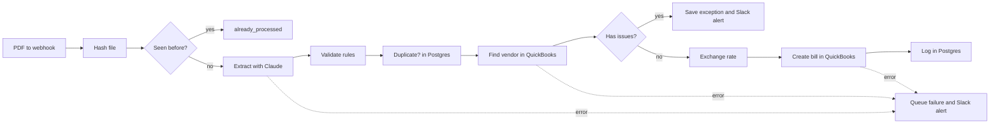

# Invoice to QuickBooks

I built an n8n workflow that reads vendor invoice PDFs with Claude, checks them against bookkeeping rules and posts the clean ones to QuickBooks Online as bills.

## The problem

A bookkeeping firm gets hundreds of vendor invoices as PDFs from its clients and retypes each one into QuickBooks. A wrong total or a duplicate only shows up weeks later, at bank reconciliation.

## How it works

- A PDF comes in through a webhook. I hash it, so the same file never gets posted twice.
- Claude reads the PDF and fills a fixed schema. The prompt tells it to copy values as printed, never to fix them, so a wrong total stays wrong and gets caught.
- One Code node runs the rules, one function per rule. Postgres checks for a repeated invoice number and QuickBooks checks the vendor exists.
- A clean invoice becomes a bill: one expense line per item, tax on its own line, and GBP bills at QuickBooks' exchange rate for the invoice date.
- An invoice with a problem goes to an exceptions table and a one-line Slack alert with the reason in plain words.
- If Claude or QuickBooks still fails after retries, the file goes to a failure queue and its hash is released, so it can be sent again.

## Validation rules

| Code | Rule | Example from the test batch |
| --- | --- | --- |
| `missing_field` | Vendor, tax id, number, dates, currency, totals and at least one line must be present | none planted; a page with no invoice number would land here |
| `sum_mismatch` | Line amounts add up to the subtotal, and subtotal plus tax to the total, within 0.01 | inv_022: 101.43 + 8.37 printed as 190.80 |
| `bad_dates` | Both dates are real dates and the due date is not before the invoice date | inv_005: issued 2026-08-15, due 2026-07-16 |
| `bad_tax_id` | US EIN as `12-3456789`, UK VAT as `GB123456789` | inv_041: EIN 67-881231, one digit short |
| `duplicate` | Same vendor and invoice number already posted | inv_024 repeats INV/08341 from inv_019 |
| `unknown_vendor` | No QuickBooks vendor with that exact name | inv_032: Munoz Safety Supply Co |

## Results

I tested it on 50 synthetic invoices in 3 layouts: 45 clean and 5 with one planted error each.

- Caught 5 of 5 planted errors, each with the right code.
- 0 false alarms: all 45 clean invoices posted as bills.
- 100% field accuracy: 50 of 50 on each of the 9 header fields and 165 of 165 line items.
- 7.1 seconds per invoice on average, from upload to bill.

These PDFs are generated, not scanned, so real invoices will score lower on extraction. That is why the rules and the exception list do the real work. Full table in [docs/results.md](docs/results.md), exceptions in [docs/exceptions.xlsx](docs/exceptions.xlsx).

## Run it yourself

You need Python 3.11, an n8n instance reachable over https, a QuickBooks Online sandbox company, an Anthropic API key, a Supabase project and a Slack incoming webhook.

1. `pip install -r requirements.txt`, then copy `.env.example` to `.env` and fill it in.
2. In n8n, create the credentials `portfolio QuickBooks` (OAuth2, sandbox), `portfolio Anthropic` (Header Auth, `x-api-key`) and `portfolio Supabase` (Postgres). Put their ids in `config/n8n.json` as `CRED_QUICKBOOKS`, `CRED_ANTHROPIC` and `CRED_SUPABASE`.
3. In the QuickBooks sandbox, turn on multicurrency (Settings > Advanced > Currency).
4. `python scripts/check_env.py` until every service says ok.
5. `python scripts/create_tables.py` and `python scripts/make_invoices.py`.
6. `python scripts/deploy_n8n.py n8n/qbo-setup.json`, then `python scripts/run_setup.py` to create the vendors and pick the expense account.
7. `python scripts/deploy_n8n.py n8n/invoice-intake.json`.
8. `python scripts/upload_invoices.py --reset`, then `python scripts/score.py --label "Run 1"` and `python scripts/export_exceptions.py`.

## Notes

- The QuickBooks node cannot set a vendor currency, a bill number or a variable number of bill lines, so Create vendor and Create bill use HTTP Request with the same QuickBooks credential.
- `claude-sonnet-5-5` rejects a forced tool choice, so Extract uses `tool_choice: auto` with a strict schema and a prompt that names `record_invoice`. If the model skips the tool, Validate flags `missing_field`.
- The n8n Code node blocks the `crypto` module, so Hash file is n8n's Crypto node. Read PDF turns the file into base64 first, because n8n keeps binaries on disk.
- The sandbox started USD only. I turned on multicurrency, which QuickBooks cannot undo, and the setup workflow adds GBP.
- QuickBooks rejects a GBP bill without an exchange rate, so the Exchange rate node reads QuickBooks' own rate for the invoice date. For USD it returns 1.
- n8n's Postgres node does not trust Supabase's certificate chain, so the Supabase credential uses "Ignore SSL Issues". Traffic is still TLS. In production I would give n8n Supabase's CA through `NODE_EXTRA_CA_CERTS`.
- I created the n8n credentials through the public API. Its schemas ask for fields the UI fills in by itself, like `sshTunnel` on Postgres.
- In the Intuit developer portal, Redirect URIs now live under the app's Settings, not under Keys and credentials.
- I added a `{{QBO_REALM_ID}}` placeholder, because the HTTP Request URLs need the company id.
- Tax goes on its own bill line, to the same expense account as the items.
- Nodes beyond the plan: Read PDF, New file?, Collect issues, Exchange rate, and one respond node per outcome.
- Files beyond the plan: `scripts/invoice_pdf.py` (PDF drawing), `scripts/export_n8n.py` (export with the secret check) and `.gitattributes` (PDF and xlsx are binary).
