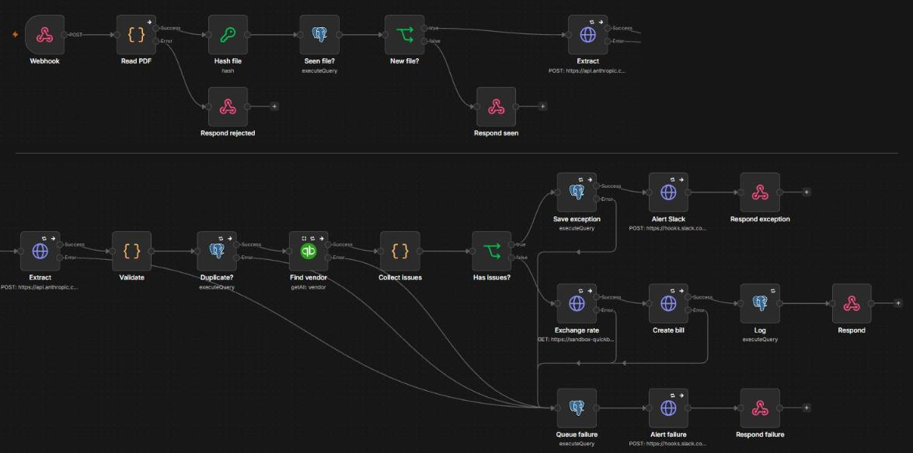
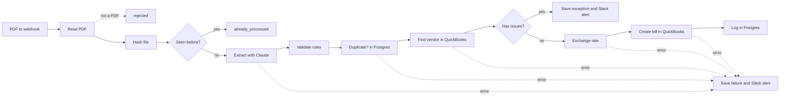
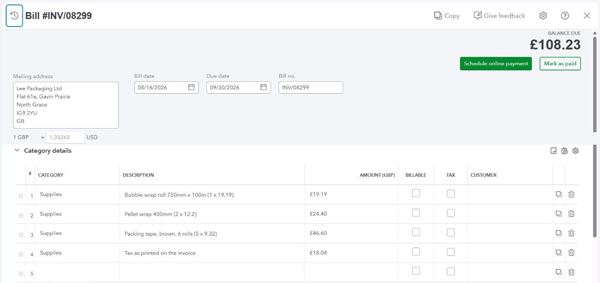

# Invoice to QuickBooks

I built an n8n workflow that reads vendor invoice PDFs with Claude, checks them against bookkeeping rules and posts the clean ones to QuickBooks Online as bills.

## The problem

A bookkeeping firm gets hundreds of vendor invoices as PDFs from its clients and retypes each one into QuickBooks. A wrong total or a duplicate only shows up weeks later, at bank reconciliation.

## How it works

- A PDF comes in through a webhook that needs a token. Anything that is not a PDF, or is over 10 MB, is turned away before it costs a model call.
- I hash each file, so the same file never gets posted twice.
- Claude reads the PDF and fills a fixed schema. The prompt tells it to copy values as printed, never to fix them, so a wrong total stays wrong and gets caught.
- One Code node runs the rules, one function per rule. Postgres checks for a repeated invoice number, and QuickBooks checks that the vendor exists and bills in the same currency.
- A clean invoice becomes a bill: one expense line per item, tax on its own line, and GBP bills at QuickBooks' exchange rate for the invoice date.
- An invoice with a problem goes to an exceptions table and a one-line Slack alert with the reason and the numbers behind it. Once the cause is fixed, the same file can be sent again.
- If Claude, Postgres or QuickBooks still fails after retries, the file goes to a failures table and Slack, and can be sent again.

For the demo a script posts the PDFs. An email inbox or a Drive folder can feed the same webhook.

## Validation rules

| Code | Rule | Example |
| --- | --- | --- |
| `missing_field` | Vendor, tax id, number, dates, currency, totals and an amount on every line must be present | none planted; a page with no invoice number lands here |
| `sum_mismatch` | Line amounts add up to the subtotal, and subtotal plus tax to the total, within 0.01 | inv_022: subtotal 101.43 + tax 8.37 = 109.80, total printed as 190.80 |
| `bad_dates` | Both dates are real dates and the due date is not before the invoice date | inv_005: issued 2026-08-15, due 2026-07-16 |
| `bad_tax_id` | US EIN as `12-3456789`, UK VAT as `GB123456789` (spaces allowed) | inv_041: EIN 67-881231, one digit short |
| `duplicate` | Same vendor and invoice number already posted | inv_024 repeats INV/08341 from inv_019 |
| `unknown_vendor` | No QuickBooks vendor with that exact name | inv_032: Munoz Safety Supply Co |
| `currency_mismatch` | The invoice currency is the vendor's currency in QuickBooks | none planted; a USD invoice from a GBP vendor in testing |

## Results

I tested it on 50 synthetic invoices in 3 layouts (34 in USD, 16 in GBP): 45 clean and 5 with one planted error each.

- Caught 5 of 5 planted errors, each with the right code.
- 0 false alarms: all 45 clean invoices posted as bills.
- 100% field accuracy: 50 of 50 on each of the 9 header fields and 165 of 165 line items.
- 7.7 seconds on average from upload to bill.
- About $0.01 of Claude API per invoice ($0.52 for the 50).

That is the Layout A sample ([docs/samples/sample_layout_a.pdf](docs/samples/sample_layout_a.pdf)) as a bill: one line per item, VAT on its own line, GBP at QuickBooks' rate for the invoice date.

These PDFs are generated, not scanned, so real invoices will score lower on extraction. A misread amount still fails the sum check and a misread vendor name fails the QuickBooks lookup, so those go to the exception list instead of the books. Full table in [docs/results.md](docs/results.md), exceptions in [docs/exceptions.xlsx](docs/exceptions.xlsx).

## Run it yourself

You need Python 3.11, an n8n instance reachable over https, a QuickBooks Online sandbox company, an Anthropic API key, a Supabase project and a Slack incoming webhook.

1. `pip install -r requirements.txt`, then copy `.env.example` to `.env` and fill it in. `QBO_REALM_ID` is the sandbox Company ID. `QBO_SETUP_PATH` and `INTAKE_TOKEN` can be any long random strings.
2. In n8n, create four credentials: `portfolio QuickBooks` (OAuth2, sandbox), `portfolio Anthropic` (Header Auth, `x-api-key`), `portfolio Supabase` (Postgres) and `portfolio Intake Token` (Header Auth, name `X-Intake-Token`, value `INTAKE_TOKEN`). Put their ids in `config/n8n.json` as `{"CRED_QUICKBOOKS": "...", "CRED_ANTHROPIC": "...", "CRED_SUPABASE": "...", "CRED_INTAKE": "..."}`. The id is the last part of the credential's URL in n8n.
3. In the QuickBooks sandbox, turn on multicurrency (Settings > Advanced > Currency).
4. `python scripts/check_env.py` until every service says ok.
5. `python scripts/create_tables.py` and `python scripts/make_invoices.py`.
6. `python scripts/deploy_n8n.py n8n/qbo-setup.json`, then `python scripts/run_setup.py` to create the vendors and pick the expense account.
7. `python scripts/deploy_n8n.py n8n/invoice-intake.json`, then try one file: `python scripts/upload_invoices.py --files docs/samples/sample_layout_a.pdf`.
8. `python scripts/upload_invoices.py --reset`, then `python scripts/score.py --label "Run 1"` and `python scripts/export_exceptions.py`.

## Notes

- The QuickBooks node cannot set a vendor currency, a bill number or a variable number of bill lines, so Create vendor and Create bill use HTTP Request with the same QuickBooks credential.
- Create bill sends a `requestid`, so a retried POST gets the first answer back instead of making a second bill.
- When QuickBooks returns an error, the Find vendor node fires both its outputs. Collect issues checks for that and leaves the run to the failure path.
- `claude-sonnet-5-5` rejects a forced tool choice, so Extract uses `tool_choice: auto` with a strict schema and a prompt that names `record_invoice`. If the model skips the tool, Validate flags `missing_field`.
- The n8n Code node blocks the `crypto` module, so Hash file is n8n's Crypto node. Read PDF turns the file into base64 first, because n8n keeps binaries on disk.
- The sandbox started USD only. I turned on multicurrency, which QuickBooks cannot undo, and the setup workflow adds GBP.
- QuickBooks rejects a GBP bill without an exchange rate, so the Exchange rate node reads QuickBooks' own rate for the invoice date. For USD it returns 1.
- n8n's Postgres node does not trust Supabase's certificate chain, so the Supabase credential uses "Ignore SSL Issues". Traffic is still TLS. In production I would give n8n Supabase's CA through `NODE_EXTRA_CA_CERTS`.
- Text from the PDF is escaped before it goes to Slack, and the spreadsheet stores text from the PDF as text, never as a formula. A vendor name cannot ping a channel or plant a link in the sheet.
- The HTTP Request nodes call `sandbox-quickbooks.api.intuit.com`. A live company needs `quickbooks.api.intuit.com` and production keys.
- I created the n8n credentials through the public API. Its schemas ask for fields the UI fills in by itself, like `sshTunnel` on Postgres.
- In the Intuit developer portal, Redirect URIs now live under the app's Settings, not under Keys and credentials.
- Placeholders in the workflow files are filled at deploy time. Besides the usual ones I added `{{QBO_REALM_ID}}`, because the HTTP Request URLs need the company id, and `{{CRED_INTAKE}}` for the webhook token.
- Tax goes on its own bill line, to the same expense account as the items.
- Helper nodes not in the diagram: New file?, Collect issues and one respond node per outcome.
- `scripts/export_n8n.py` pulls the live workflows back into `n8n/` and refuses to write a file that still holds an API key, a token, a Slack webhook URL or the company id.
- `scripts/invoice_pdf.py` draws the test PDFs, and `.gitattributes` keeps PDF, PNG and xlsx files binary.
